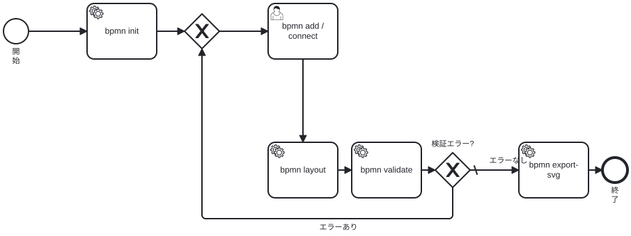

# bpmn-cli

標準 BPMN 2.0 XML をターミナルから作成・編集・検証・自動レイアウトし、bpmn-js と同一の SVG をブラウザレスで出力する CLI です。
論理構造（BPMN 要素）と図形情報（BPMN DI）を分離し、DI は **bpmn layout** を実行したときだけ生成します。
出力は Camunda Modeler / bpmn-js などで開ける標準 BPMN 2.0 です。

## 特徴

- 開始イベント、終了イベント、タスク、ゲートウェイ、シーケンスフローを作成できる
- 条件式とデフォルトフローを扱える
- **bpmn layout** で図形座標と BPMN DI を自動生成する
- **bpmn validate** で bpmnlint と独自の参照整合性検査を実行する
- **bpmn validate --style** で図の読みやすさ（フロー方向、交差、重なり、デフォルトフロー）を検査する
- **bpmn export-svg** で bpmn-js と同じ SVG をブラウザレスで出力する
- すべてのコマンドが **--format json** に対応する
- 終了コードとエラー形式が固定されている
- 既存 DI を勝手に壊さない（再レイアウトには **--force** が必要）
- 書き込みは一時ファイル + rename の原子的更新

## 必要環境

- Node.js 24 以上（bpmnlint 12 の要件。開発・テストは Node.js 26 で確認済み）
- pnpm 11.28.5 以上（package.json の packageManager は 11.28.5。12.18.0 でも動作確認済み）

## インストールとビルド

npm レジストリからグローバルにインストールする場合:

~~~bash
npm install -g @f12o/bpmn-cli
~~~

pnpm を使う場合:

~~~bash
pnpm setup      # 初回のみ。global bin を PATH に追加
pnpm add -g @f12o/bpmn-cli
~~~

リポジトリからビルドする場合:

~~~bash
pnpm install
pnpm run build
~~~

リポジトリ内で実行する場合:

~~~bash
node dist/cli.js --help
~~~

グローバルに **bpmn** コマンドとして使う場合:

~~~bash
# pnpm 12 では "pnpm link --global" は廃止されています。
# ローカルパッケージをグローバルに追加します。
pnpm setup      # 初回のみ。global bin を PATH に追加
pnpm add -g .
bpmn --help
~~~

**pnpm link --global** は pnpm 10/11 の旧構文です。pnpm 12 では次のように失敗します。

~~~text
error: unexpected argument '--global' found
~~~

**pnpm setup** の後に **bpmn** が見つからない場合は、シェルを再起動するか、
**pnpm bin -g** が返すディレクトリを PATH に追加してください。

pnpm の store が読み取り専用の環境では、書き込み可能なディレクトリを指定してください:

~~~bash
pnpm install --store-dir /tmp/bpmn-cli-pnpm-store
~~~

## クイックスタート

~~~bash
# 新規作成
bpmn init approval.bpmn --name "承認業務"

# 要素を追加
bpmn add start approval.bpmn --id start
bpmn add task approval.bpmn --id request --name "申請"
bpmn add gateway approval.bpmn --id decision --type exclusive
bpmn add task approval.bpmn --id approve --name "承認"
bpmn add end approval.bpmn --id end

# 接続
bpmn connect approval.bpmn start request
bpmn connect approval.bpmn request decision
bpmn connect approval.bpmn decision approve
bpmn connect approval.bpmn approve end

# 図形配置と DI を生成
bpmn layout approval.bpmn

# 検査
bpmn validate approval.bpmn

# 機械可読な一覧
bpmn list approval.bpmn --format json

# SVG 出力（DI がなければメモリ上でレイアウト）
bpmn export-svg approval.bpmn --output approval.svg
~~~

### ゲートウェイ分岐の例

~~~bash
# クイックスタートで decision -> approve は Flow_3 として作成済み
bpmn update approval.bpmn Flow_3 --default

bpmn add task approval.bpmn --id reject --name "却下"
bpmn connect approval.bpmn decision reject --condition "approved == false" --name "却下"
bpmn add end approval.bpmn --id rejected --name "却下終了"
bpmn connect approval.bpmn reject rejected

bpmn layout approval.bpmn --force
bpmn validate approval.bpmn
~~~

シェルでは条件式を必ず引用してください。BPMN の式として **${...}** 形式を使う場合も、シェル側の展開を防ぐためにシングルクォートで囲むのが安全です。

## bpmn-cli 自身のワークフロー

クイックスタートの流れを BPMN で表すと次のようになります。
この SVG は bpmn-cli 自身の **bpmn export-svg** で生成し、**bpmn validate --style** で検証しています。

[BPMN ソース](docs/bpmn-cli-workflow.bpmn)

基本ワークフローの例であり、全コマンドの分岐や内部実装を網羅するものではありません。
図は README 用に見やすく配置してあり、再生成時は layout を実行せず export-svg だけを使います。

~~~bash
bpmn validate docs/bpmn-cli-workflow.bpmn --style
bpmn export-svg docs/bpmn-cli-workflow.bpmn --output docs/bpmn-cli-workflow.svg --force
~~~

## コマンド一覧

| コマンド | 用途 |
|---|---|
| **bpmn init** | 空の Definitions + Process を作成 |
| **bpmn add** | フローノードを追加 |
| **bpmn connect** | シーケンスフローを追加 |
| **bpmn remove** | 要素またはフローを削除 |
| **bpmn rename** | 名前を変更 |
| **bpmn update** | 条件・デフォルトフロー・実行属性などを更新 |
| **bpmn list** | 内容を一覧表示 |
| **bpmn layout** | 自動レイアウトと DI 生成 |
| **bpmn export-svg** | bpmn-js 互換の SVG をブラウザレスで生成 |
| **bpmn validate** | 構文・意味・参照整合性の検証 |

すべてのコマンドに **--format text|json** があります。デフォルトは **text** です。
JSON モードでは stdout に JSON だけを出力し、警告も JSON 内の **warnings** に含めます。
致命的エラーは stderr に JSON で出力します。

## 各コマンド

### init

~~~bash
bpmn init <file> [options]
~~~

| オプション | 説明 |
|---|---|
| **--name <name>** | Process の名前 |
| **--id <id>** | Process の ID（デフォルト: Process_1） |
| **--namespace <uri>** | targetNamespace（デフォルト: http://bpmn.io/schema/bpmn） |
| **--executable** | isExecutable を true にする（デフォルト: false） |
| **--force** | 既存ファイルを上書きする |
| **--layout** | 作成時にレイアウトを試みる（空の Process では DI を作らない） |

既存ファイルがある場合、**--force** がない限り失敗します。
**--layout** を指定した場合も、レイアウトが成功するまでファイルは書き込みません。

### add

~~~bash
bpmn add <kind> <file> [options]
~~~

**kind**:

- **start**: bpmn:StartEvent
- **end**: bpmn:EndEvent
- **task**: bpmn:Task またはサブタイプ
- **gateway**: bpmn:ExclusiveGateway など

| オプション | 説明 |
|---|---|
| **--id <id>** | 要素 ID。省略時は StartEvent_1 などの連番 |
| **--name <name>** | 要素名 |
| **--type <type>** | task / gateway のサブタイプ |
| **--process <id>** | 対象 Process。Process が複数ある場合は必須 |

**task** の type:

- **task**（デフォルト）
- **user**
- **service**
- **script**
- **manual**
- **business-rule**
- **send**
- **receive**

**gateway** の type:

- **exclusive**（デフォルト）
- **parallel**
- **inclusive**
- **event-based**
- **complex**

start / end に **--type** は指定できません。
既存 DI があるファイルに追加した場合、新要素には DI がないため **STALE_DI** 警告を出します。

### connect

~~~bash
bpmn connect <file> <source> <target> [options]
~~~

| オプション | 説明 |
|---|---|
| **--id <id>** | シーケンスフロー ID。省略時は Flow_1 などの連番 |
| **--name <name>** | フローのラベル |
| **--condition <expr>** | 条件式（bpmn:FormalExpression） |
| **--default** | ソースのデフォルトフローにする |

source と target は同じ Process または同じ SubProcess に属している必要があります。
同じ source / target の重複フローはエラーです。
**--condition** と **--default** は同時に指定できません。

### remove

~~~bash
bpmn remove <file> <id> [--cascade]
~~~

- シーケンスフローはそのまま削除できます。
- 接続フローや子要素を持つノードは **--cascade** が必要です。
- **--cascade** は接続フロー、子要素、付随する境界イベントも削除します。
- 削除した要素の BPMN DI エントリは削除します。残りのレイアウトは保持します。
- 削除したフローがデフォルトフローなら、source の default 属性も解除します。

Process / Collaboration / Participant / Lane 自体の削除はこのバージョンでは未対応です。

### rename

~~~bash
bpmn rename <file> <id> --name <name>
~~~

空文字を渡すと name 属性を削除します。
対象は Process、フローノード、シーケンスフロー、Participant、Lane です。

### update

~~~bash
bpmn update <file> <id> [options]
~~~

| オプション | 説明 |
|---|---|
| **--name <name>** | 名前を変更（空文字で削除） |
| **--condition <expr>** | シーケンスフローの条件式を設定 |
| **--clear-condition** | 条件式を削除 |
| **--default** | シーケンスフローを source のデフォルトにする |
| **--no-default** | デフォルト設定を解除 |
| **--executable** | Process を executable にする |
| **--no-executable** | Process を non-executable にする |

少なくとも 1 つのオプションが必要です。
**--condition** と **--default**、**--condition** と **--clear-condition**、**--default** と **--no-default** は同時に指定できません。
デフォルトフローに条件式は設定できません。

### list

~~~bash
bpmn list <file> [--format json]
~~~

Process、Collaboration、Participant、Lane、FlowNode、SequenceFlow、MessageFlow、DI の概要を表示します。
**incoming / outgoing** は保存値ではなく、シーケンスフローから導出した値です。

### layout

~~~bash
bpmn layout <file> [options]
~~~

| オプション | 説明 |
|---|---|
| **--force** | 既存 DI を置き換える。既存の出力ファイルも上書きする |
| **--output <path>** | 別ファイルへ書き出す。入力は変更しない |
| **--stdout** | XML を stdout に書き出す。ファイルは変更しない |

- 入力に既存 DI があり、インプレースで書き込む場合は **--force** が必須です。
- **--output** 先が既存ファイルの場合は **--force** が必須です。
- **--output** が入力と同じパスならインプレース扱いです。
- **--stdout** は **--output** と併用できません。また **--format json** とも併用できません。
- レイアウト対象が空の場合は警告だけを出し、ファイルを変更しません。
- レイアウト結果は再パースし、DI 以外の BPMN 要素の ID / 型が変化していないことを検査します。変化があれば書き込みません。
- LayoutError が発生した場合は終了コード 4 で、元のレイアウトエラーコードを JSON の details に含めます。

### export-svg

~~~bash
bpmn export-svg <file> [options]
~~~

| オプション | 説明 |
|---|---|
| **--output <path>** | SVG の出力先。省略時は入力の .bpmn を .svg に置換 |
| **--stdout** | SVG を stdout に書き出す。ファイルは作成しない |
| **--force** | 既存の SVG を上書きする |
| **--diagram <id>** | 複数の BPMNDiagram がある場合に描画する ID を選ぶ |
| **--relayout** | 既存 DI も無視し、メモリ上で再レイアウトしてから描画する |

- 入力に DI がない場合は、メモリ上で bpmn-auto-layout を実行してから描画します。BPMN ファイルは変更しません。
- 入力に DI がある場合は、その DI をそのまま使います。**--relayout** を指定した場合だけ再生成します。
- 複数の BPMNDiagram があり **--diagram** を省略した場合は、先頭の diagram を使い **SVG_MULTIPLE_DIAGRAMS** 警告を出します。
- 出力先が入力 BPMN と同じパスになる場合は、**--force** があっても拒否します。
- **--stdout** は **--output** と併用できません。また **--format json** とも併用できません。
- フロー要素が 1 つもない場合は **E_SVG_EMPTY** で失敗します。

#### ブラウザレス実行

SVG 出力はブラウザを起動しません。bpmn-js 18.31.1 の **Viewer#saveSVG()** を、次の組み合わせで Node.js 上で実行します。

- **svgdom**: HTML / SVG DOM
- **@napi-rs/canvas**: テキスト計測（Skia）
- **esbuild**: bpmn-js の Node / Chrome 共用バンドル

bpmn-js のレンダリングコード自体は変更していません。最小構成の BaseViewer に Core と Selection を組み合わせ、HTML オーバーレイを使わずに SVG を生成します。

#### 「bpmn-js と同一」の範囲

- bpmn-js 18.31.1 の **saveSVG()** が生成する SVG ツリーを基準にします。
- ブラウザ由来の差（hsl → rgb、ランダムな marker ID、matrix の丸め、stroke-dasharray の空白、root viewBox の小数）は正規化します。
- テストでは Chrome で生成した参照 SVG と、正規化後のツリーおよび **@resvg/resvg-js + pixelmatch** のラスタ画像を比較し、ピクセル差分 0 を確認しています。
- SVG のバイト列一致や、異なる OS / フォント環境でのピクセル一致は保証しません。

#### フォント

テキスト計測には次のフォントを使います。

- Latin: **Liberation Sans**（Arial の代替）
- CJK: **Noto Sans CJK JP**

Linux では /usr/share/fonts/truetype/liberation/LiberationSans-Regular.ttf を自動で使います。別のフォントを使う場合は、計測用フォントの絶対パスを **BPMN_SVG_FONT** に、フォントディレクトリを **BPMN_SVG_FONT_DIR** に指定してください。フォントが見つからない場合も描画は続行しますが、ラベル折り返しや viewBox が参照環境とずれることがあります。

参照環境は Linux x64、Node.js 26、Chrome、Liberation Sans、Noto Sans CJK JP です。異なるフォント環境で完全一致が必要な場合は、同じフォントを指定してください。

### validate

~~~bash
bpmn validate <file> [options]
~~~

| オプション | 説明 |
|---|---|
| **--config <path>** | bpmnlint 設定 JSON。デフォルト設定を置き換える |
| **--no-lint** | bpmnlint を実行せず、構造チェックだけを行う |
| **--style** | 図の読みやすさを検査する（warning / info のみ） |

- error が 1 件以上なら終了コード 1、warning のみなら 0 です。
- ファイルは変更しません。

#### デフォルトの lint 設定

bpmnlint の **recommended** を継承し、次の 2 ルールだけを **warn** に変更します。

- **label-required**: ラベルは表示上の推奨であるため
- **no-bpmndi**: DI は layout で生成するため。論理構造だけの検証を可能にする

厳密に recommended を使いたい場合は、次のような設定ファイルを **--config** で渡してください。

~~~json
{
  "extends": ["bpmnlint:recommended"]
}
~~~

#### 独自の構造チェック

- 重複 ID
- シーケンスフローの端点欠落 / 非 FlowNode / スコープ跨ぎ
- メッセージフローの端点欠落・不正な端点
- Participant の processRef 未解決
- Lane の flowNodeRef 未解決 / プロセス外参照
- デフォルトフローの未解決 / 非 outgoing
- 境界イベントの attachedToRef 未解決 / スコープ不一致
- incoming / outgoing の保存値と導出値の不一致（警告）
- DI がある場合の DI 欠落 / 古い DI 参照（警告）
- コラボレーションなしの複数プロセス（警告）
- パース警告

BPMN の incoming / outgoing 要素は省略可能ですが、bpmnlint と bpmn-auto-layout はこれらを参照します。
validate と layout の内部では、シーケンスフローから incoming / outgoing を再構築してから処理します。

#### 作図スタイル（--style）

~~~bash
bpmn validate approval.bpmn --style
bpmn validate approval.bpmn --style --format json
~~~

**--style** は、Camunda の「読みやすいプロセスモデル」に基づく図の検査を追加します。
指摘は warning / info のみで、終了コードは変わりません。

| ルール | 内容 |
|---|---|
| **style/flow-direction** | ループ以外のシーケンスフローが右から左へ流れている |
| **style/flow-crossing** | 異なるシーケンスフローの線分が交差している |
| **style/element-overlap** | フローノードの図形が重なっている |
| **style/gateway-default** | 複数の outgoing を持つ排他/包含ゲートウェイにデフォルトフローがない |
| **style/no-di** | DI がないため style のジオメトリ検査を実行できない（info） |

- 検査には BPMN DI が必要です。先に **bpmn layout** を実行してください。
- ループの戻り辺は **style/flow-direction** の対象外です。
- bpmnlint と併用する場合は **--style** だけを追加します。**--no-lint** と併用すれば style だけを実行できます。
- 図の読みやすさの詳細は [SKILL.md](skills/bpmn-cli/SKILL.md) にまとめています。
- ルールの背景は Camunda の [Creating readable process models](https://docs.camunda.io/docs/components/best-practices/modeling/creating-readable-process-models/) を参照してください。
- Camunda 公式の Camunda 8 向け skill は [camunda/skills](https://github.com/camunda/skills/blob/main/skills/camunda-bpmn/SKILL.md) にあります。bpmn-cli は汎用 BPMN 2.0 向けで、Zeebe 拡張や c8ctl は扱いません。

## 終了コード

| コード | 意味 |
|---|---|
| 0 | 成功。validate は error なし |
| 1 | validate で error が見つかった |
| 2 | 引数・オプションの usage error |
| 3 | 入力 / IO / XML パースエラー |
| 4 | 操作エラー（要素不在、重複、スコープ違反、DI 上書き拒否、layout 失敗など） |
| 5 | 内部エラー |

## JSON 出力

すべての JSON に **schemaVersion: 1**、**tool**、**ok**、**command**、**file** が含まれます。

### 成功例（add）

~~~json
{
  "schemaVersion": 1,
  "tool": { "name": "bpmn-cli", "version": "0.2.0" },
  "ok": true,
  "command": "add",
  "file": "approval.bpmn",
  "changes": [
    {
      "op": "add",
      "id": "request",
      "type": "bpmn:Task",
      "name": "申請"
    }
  ],
  "di": { "present": false, "stale": false },
  "warnings": []
}
~~~

### list の主要フィールド

~~~json
{
  "definitions": { "id": "Definitions_1", "targetNamespace": "http://bpmn.io/schema/bpmn" },
  "processes": [{ "id": "Process_1", "name": "承認業務", "isExecutable": false }],
  "collaborations": [],
  "lanes": [],
  "elements": [
    {
      "id": "request",
      "type": "bpmn:Task",
      "kind": "task",
      "name": "申請",
      "processId": "Process_1",
      "containerId": "Process_1",
      "containerType": "bpmn:Process",
      "incoming": ["Flow_1"],
      "outgoing": ["Flow_2"],
      "default": null,
      "attachedTo": null
    }
  ],
  "flows": [
    {
      "id": "Flow_1",
      "type": "bpmn:SequenceFlow",
      "name": null,
      "processId": "Process_1",
      "containerId": "Process_1",
      "source": "start",
      "target": "request",
      "condition": null,
      "isDefault": false
    }
  ],
  "messageFlows": [],
  "di": {
    "present": false,
    "content": false,
    "diagrams": 0,
    "shapes": 0,
    "edges": 0,
    "missing": 0,
    "stale": 0
  },
  "counts": { "elements": 5, "flows": 4, "messageFlows": 0, "lanes": 0, "participants": 0 },
  "warnings": []
}
~~~

### validate

~~~json
{
  "schemaVersion": 1,
  "tool": { "name": "bpmn-cli", "version": "0.2.0" },
  "ok": false,
  "command": "validate",
  "file": "approval.bpmn",
  "valid": false,
  "findings": [
    {
      "severity": "error",
      "source": "lint",
      "rule": "end-event-required",
      "message": "Process is missing end event",
      "elementId": "Process_1"
    }
  ],
  "summary": { "errors": 1, "warnings": 0, "infos": 0 },
  "warnings": []
}
~~~

### export-svg

~~~json
{
  "schemaVersion": 1,
  "tool": { "name": "bpmn-cli", "version": "0.2.0" },
  "ok": true,
  "command": "export-svg",
  "file": "approval.bpmn",
  "output": "approval.svg",
  "wrote": true,
  "format": "svg",
  "bpmnJs": "18.31.1",
  "diagram": { "id": "BPMNDiagram_Process_1", "name": null },
  "di": { "present": true, "generated": false, "shapes": 6, "edges": 4 },
  "svg": {
    "width": 732,
    "height": 254.1,
    "viewBox": "75 70.9 732 254.1",
    "bytes": 12345
  },
  "warnings": []
}
~~~

### エラー

~~~json
{
  "schemaVersion": 1,
  "tool": { "name": "bpmn-cli", "version": "0.2.0" },
  "ok": false,
  "command": "add",
  "file": "approval.bpmn",
  "error": {
    "code": "E_ELEMENT_NOT_FOUND",
    "message": "Element not found: foo",
    "hint": "Run \"bpmn list <file> --format json\" to inspect element ids.",
    "details": { "id": "foo" }
  }
}
~~~

エラーコードの主なもの:

- **E_USAGE**
- **E_FILE_NOT_FOUND** / **E_READ_FAILED** / **E_WRITE_FAILED** / **E_PARSE_FAILED** / **E_NOT_BPMN**
- **E_FILE_EXISTS** / **E_ELEMENT_EXISTS** / **E_ELEMENT_NOT_FOUND**
- **E_CROSS_SCOPE_FLOW** / **E_DUPLICATE_FLOW** / **E_INVALID_ENDPOINT**
- **E_DEFAULT_EXISTS** / **E_DEFAULT_FLOW_CONDITION** / **E_INVALID_DEFAULT**
- **E_REMOVE_REQUIRES_CASCADE**
- **E_LAYOUT_OVERWRITE_DI** / **E_LAYOUT_FAILED** / **E_LAYOUT_INTEGRITY**
- **E_SVG_RUNTIME** / **E_SVG_RENDER**
- **E_SVG_EMPTY** / **E_DIAGRAM_NOT_FOUND** / **E_SVG_OUTPUT_SAME_AS_INPUT**
- **E_INTERNAL**

## レイアウトと DI の扱い

- **add** / **connect** は論理構造だけを変更し、既存 DI を保持します。
- 既存 DI がある状態で要素を追加すると、新要素は DI を持ちません。**STALE_DI** 警告を出します。
- **layout** だけが DI を生成・再生成します。
- bpmn-auto-layout 2.0.0-alpha.2 は既存 DI を全消去して再生成するため、インプレース実行には **--force** が必要です。
- **remove** は削除対象の DI エントリだけを削除します。残りの座標は保持します。
- サブプロセスは別の BPMNDiagram を持つことがあります。サブプロセス削除時は、その plane ごと削除します。
- 複数プロセスがあり、コラボレーションがない場合、bpmn-auto-layout は先頭プロセスだけをレイアウトします。**MULTIPLE_PROCESSES** 警告を出します。

## ファイルの安全性

- 読み込みは UTF-8。先頭 BOM は除去します。
- 書き込みは同一ディレクトリの一時ファイル + rename です。
- 既存ファイルのパーミッションを保持します。
- シンボリックリンクはリンク先を更新し、リンク自体は残します。
- 失敗時は一時ファイルを削除し、元ファイルを変更しません。
- XML コメント・処理命令は再シリアライズで失われます。編集前にバージョン管理することを推奨します。
- ベンダー拡張要素（Camunda の extensionElements など）は bpmn-moddle が保持できる範囲で維持します。テストでは round-trip を確認しています。

## このバージョンの制約

- 新規作成できるのは start / end / task / gateway のみです。
- 既存のサブプロセス、コラボレーション、プール、レーン、メッセージフローは読み取り・一覧・検証・レイアウトできますが、新規作成はできません。
- 中間イベント、境界イベント、イベント定義の新規作成は未対応です（既存のものは検証・レイアウト対象）。
- バッチ操作、--dry-run、stdin 入力は未対応です。
- PNG / PDF 出力、図の差分表示は未対応です。SVG は **bpmn export-svg** で出力できます。
- SVG の見た目はフォント環境に依存します。bpmn-js との完全一致は、固定したフォント環境での SVG ツリー / ピクセル比較を基準にしています。
- BPMN XSD による完全検証は行いません。bpmn-moddle のパース、bpmnlint、独自の参照整合性検査で代替します。
- レイアウトは同期的に CPU を使います。巨大な図では時間がかかります。タイムアウトや中断はありません。
- ファイルロックはありません。同時実行は last writer wins です。

## 開発

~~~bash
pnpm run build
pnpm test
pnpm run typecheck
~~~

テストは Node.js 組み込みの test runner を使い、ビルド済みの **dist/cli.js** を子プロセスとして実行します。

~~~bash
node --test test/
~~~

主な依存:

- bpmn-moddle 10.3.1
- bpmn-auto-layout 2.0.0-alpha.2（固定）
- bpmnlint 12.x
- commander 15.x
- bpmn-js 18.31.1（固定）
- svgdom 0.1.29（固定）
- @napi-rs/canvas 1.1.0（固定）
- diagram-js 15.28.1（固定）

SVG テスト用の開発依存:

- esbuild
- @resvg/resvg-js
- pixelmatch
- pngjs
- @xmldom/xmldom

bpmn-auto-layout は 2.0.0-alpha.2 を **完全固定** しています。
安定版 2.x が公開されたら、レイアウトラッパー（src/layout/auto-layout.ts）を中心に更新してください。

SVG の同一性テストは **test/fixtures/svg/** にあります。参照 SVG は bpmn-js 18.31.1 の saveSVG() を Chrome で実行して生成したもので、通常の **pnpm test** は Chrome を起動しません。ブラウザレスのラスタ比較には @resvg/resvg-js + pixelmatch を使います。

### SVG のビルド

**pnpm run build** は TypeScript のビルド後に **scripts/build-svg-runtime.mjs** を実行し、bpmn-js を **dist/svg-runtime.mjs** へバンドルします。このファイルは配布物に含まれます。

## リリース

npm パッケージは **@f12o/bpmn-cli** として公開します。
リリース版のバージョンは **CalVer（YYYY.MM.PATCH）** で、GitHub Actions から npm の **Trusted Publishing（OIDC）** を使って公開します。リポジトリに npm トークンは置きません。

- リリース元: main の履歴に含まれるコミット
- トリガー: **latest** タグの push
- バージョン: calver-action が Asia/Tokyo の日付から採番
- 公開: .github/workflows/release.yaml
- 公開前に **pnpm test** と **npm pack --dry-run** を実行

通常のリリース:

~~~bash
git tag -f latest <commit-to-release>
git push -f origin latest
~~~

### 初回だけ必要な作業

npm の trusted publisher は、パッケージが registry に存在してから設定します。
初回だけは npm にログインして手動で publish し、その後で trusted publisher を登録します。

~~~bash
npm login
git switch -c release/2026.11.0
node scripts/set-version.mjs 2026.11.0
pnpm test
npm publish --access public

git add package.json
git commit -m "chore: release @f12o/bpmn-cli 2026.11.0"
git tag 2026.11.0
git push origin 2026.11.0
git switch main

npm trust github @f12o/bpmn-cli \
  --file release.yaml \
  --repo f4ah6o/bpmn-cli \
  --allow-publish \
  -y
~~~

初回のバージョンは実行日時の CalVer に合わせてください。npm trust には npm 11.15 以上と 2FA が必要です。

## バージョン方針

- npm パッケージ名は **@f12o/bpmn-cli**、CLI の実行名は **bpmn** です。
- リポジトリ内の開発版は 0.2.0 で、リリース時に CalVer へ更新します。
- CLI のバージョンは package.json の version を実行時に読みます。
- v0.2 のスコープは README 記載のとおりです。破壊的変更は --force を伴う操作に限定しています。
- bpmn-js / diagram-js / svgdom / @napi-rs/canvas は SVG 出力の再現性のため固定バージョンを使います。
